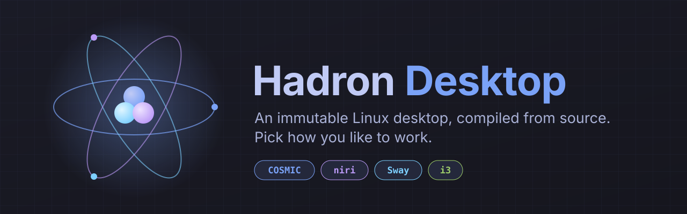
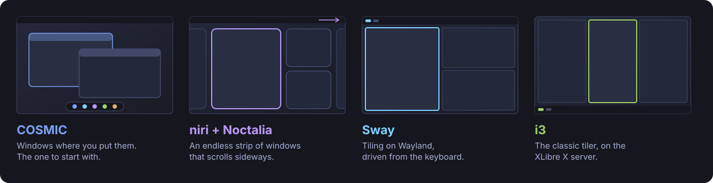

<p align="center">
  
</p>

<p align="center">
  <a href="https://github.com/kairos-community/hadron-desktop/releases/latest"></a>
  <a href="https://github.com/kairos-community/hadron-desktop/actions/workflows/ci.yml"></a>
  
  
</p>

<p align="center">
  <a href="#pick-a-desktop">Desktops</a> ·
  <a href="#what-you-get">Features</a> ·
  <a href="#install">Install</a> ·
  <a href="#updates-that-cannot-break-your-machine">Updates</a> ·
  <a href="docs/DEVELOPMENT.md">Build it yourself</a>
</p>

---

**Hadron Desktop** is a Linux desktop that you install once and then do not
have to maintain. The system is a single signed image. It updates as a whole,
and the previous version is always one reboot away. Your apps come from
Flathub, and your files stay in `/home`.

Every package is compiled from source on [Hadron](https://github.com/kairos-io/hadron),
a minimal musl-based Linux, and booted by [Kairos](https://kairos.io). There is
no package manager to break, and no partial upgrade.

## Pick a desktop

<p align="center">
  
</p>

All four have the same Hadron features, reached with the same keys. They differ
only in how they arrange your windows.

| | Desktop | For |
|---|---|---|
| 🪟 | **[COSMIC](https://system76.com/cosmic)** | People new to Linux. A modern desktop with a dock, a graphical login, a settings app and an app store. |
| 📜 | **[niri](https://github.com/YaLTeR/niri) + [Noctalia](https://github.com/noctalia-dev/noctalia)** | A scrolling desktop: new windows open to the right, and you scroll through them. Noctalia adds a polished bar, dock, launcher and control center. |
| 🧩 | **[Sway](https://swaywm.org/)** | Keyboard users who like tiling, on Wayland. |
| 🖥️ | **[i3](https://i3wm.org/)** | The classic tiling window manager, on the [XLibre](https://www.xlibre.net/) X server. |

You can change your mind later: `hadron-update switch <desktop>` moves an
installed machine to another desktop and keeps your files.

## What you get

- **One menu for everything.** <kbd>Super</kbd>+<kbd>Esc</kbd> opens the Hadron
  menu: apps, Wi-Fi, Bluetooth, audio, screenshots, emoji, clipboard history,
  night light, updates, help and power.
- **Apps on the first login.** A short checklist installs a browser (Firefox,
  Chromium, Brave or LibreWolf) and other essential apps from Flathub. File
  dialogs and dark mode work in Flatpak apps.
- **Your keys, on every desktop.** <kbd>Super</kbd>+<kbd>F1</kbd> shows all
  the shortcuts. Volume, brightness and media keys work, with an on-screen
  level.
- **Saved passwords.** The GNOME keyring unlocks with your login password, so
  browsers and Electron apps keep their secrets encrypted.
- **Small comforts.** Clipboard history on <kbd>Super</kbd>+<kbd>Ctrl</kbd>+<kbd>V</kbd>,
  an emoji picker on <kbd>Super</kbd>+<kbd>;</kbd>, a night light, notification
  keys and do not disturb. Night light is not on COSMIC yet.
- **For developers too.** Docker and [Distrobox](https://distrobox.it/) are
  included. Distrobox gives you a normal, changeable Linux inside a container.
- **A coherent look.** The boot menu, the boot animation, the login, the
  installer and the desktop all use the same Tokyo Night colors.

## Install

1. **Download an ISO** from the [latest release](https://github.com/kairos-community/hadron-desktop/releases/latest).

   | File | Use it on |
   |---|---|
   | `hadron-desktop-<desktop>-<version>-amd64.iso` | Laptops and desktops. Includes the Intel and AMD graphics drivers, the Wi-Fi, Bluetooth, GPU and audio firmware, and CPU microcode. |
   | `hadron-desktop-<desktop>-vm-<version>-amd64.iso` | Virtual machines. About 0.3 GB smaller. |

   Each ISO comes with a `.sha256` checksum, an SPDX SBOM and a build manifest
   that names every source it was built from.

2. **Write it to a USB stick**, for example with
   [Fedora Media Writer](https://github.com/FedoraQt/MediaWriter), or:

   ```sh
   sha256sum --check hadron-desktop-*.iso.sha256
   sudo dd if=hadron-desktop-cosmic-v0.0.9-amd64.iso of=/dev/sdX bs=4M status=progress oflag=sync
   ```

3. **Boot it.** The installer asks for a hostname, your user name and
   password, your keyboard layout, your timezone, and the disk to use. It
   then shows the summary before it erases anything.

> [!TIP]
> To try it in a VM first, use the `-vm` ISO. Give the VM UEFI firmware,
> 4 GB of RAM and a disk of 20 GB or more. Choose a virtio GPU if your hypervisor has one.

## Updates that cannot break your machine

A tray icon tells you when a new release is out. Click it to install the
update, then reboot when it suits you.

Updates are **A/B**. The new system is written next to the running one, and
nothing changes until you reboot. If the new version does not suit you, the
previous one is still in the boot menu.

```sh
hadron-update                 # installed version and latest release
hadron-update upgrade         # install the latest release
hadron-update rollback        # boot the previous system
hadron-update switch niri     # change to another desktop
```

Only members of the `admin` group can install updates. Release images are
signed with [cosign](https://github.com/sigstore/cosign).

## Agent edition

There is also an **agent** ISO: an i3 appliance for virtual machines that an
AI agent drives through [Cua](https://github.com/trycua/cua). It is released
only after its compatibility, install, recovery and UI tests pass. See
[docs/DEVELOPMENT.md](docs/DEVELOPMENT.md) to set it up.

## Build it yourself

Everything is built from one multi-stage `Dockerfile`, against a pinned Hadron
release, with no other source checkout:

```sh
make DESKTOP=cosmic iso      # sway, i3, cosmic or niri
make vm-install              # boot the ISO in QEMU
```

[docs/DEVELOPMENT.md](docs/DEVELOPMENT.md) explains the build, the variants,
the test harness and the release pipeline. Contributors and coding agents
should also read [AGENTS.md](AGENTS.md): every desktop gets every feature.

## Built on

[Hadron](https://github.com/kairos-io/hadron) ·
[Kairos](https://kairos.io) ·
[COSMIC](https://github.com/pop-os/cosmic-epoch) ·
[niri](https://github.com/YaLTeR/niri) ·
[Noctalia](https://github.com/noctalia-dev/noctalia) ·
[Sway](https://swaywm.org/) ·
[i3](https://i3wm.org/) ·
[XLibre](https://www.xlibre.net/) ·
[Flathub](https://flathub.org/)
